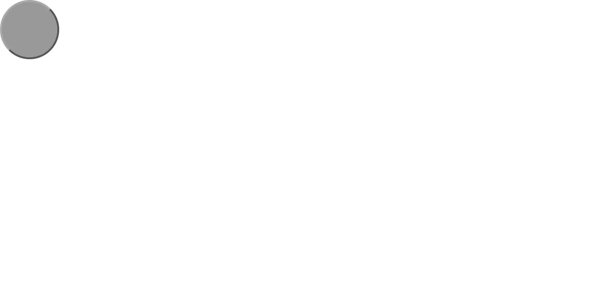
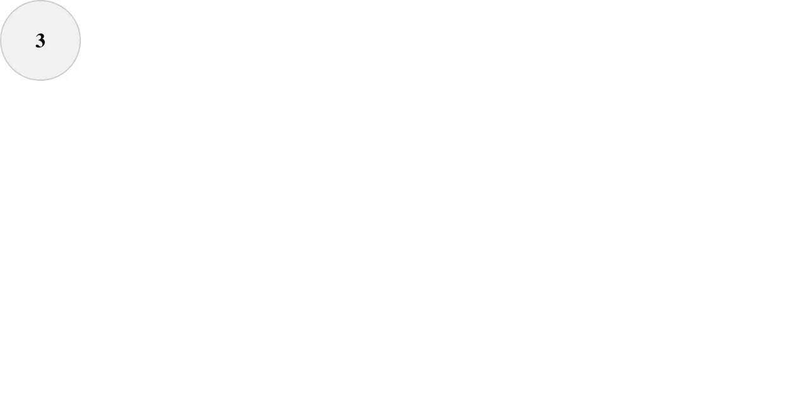
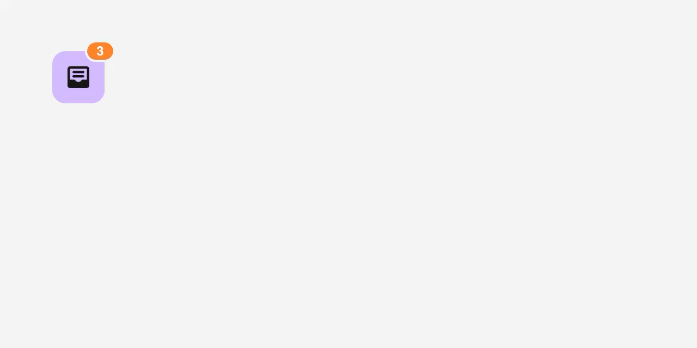

# Breaking News Coding Challenge

## 1. Project Overview

The goal was to build a draggable Floating Action Button (FAB) that can be freely positioned within the viewport.
Clicking it opens a news feed with links to various articles.

## 2. Demo & Quick Start

Clone the repository or try the live demo on Vercel.

**Live Demo:** [Link to be added]

> [!TIP]
> Press `Shift + C` to toggle the news feed between populated and empty states.

## 3. Approach & Key Decisions

### Dragging

The native HTML Drag and Drop API was not suitable for freely positioning the button. Instead, I implemented custom
dragging behavior using mouse events.

### Popover

Rather than manually controlling the visibility of the news feed, I chose the native Popover API. It provides built-in
keyboard support and focus management, making it an accessible solution.

## 4. Challenges & Learnings

### Click vs. Drag

Dragging the button also triggered its click event, causing the news feed to open unintentionally. I added logic to
distinguish between clicks and drag interactions.

### Viewport Boundaries

When the button was dragged near the edge of the viewport, the news feed could extend beyond the visible area. I used
CSS anchor positioning to keep the popover connected to the button while allowing it to reposition automatically when
space was limited.

### Type-Safe Event Handling

I used a generic event listener composable based on the approach described in the Vue documentation. My main challenge
was making it fully type-safe, particularly typing the different event types and callbacks correctly.

## 5. Development Diary

The development was divided into three phases, each focusing on a different aspect of the component.

### Step 1: Dragging

I started by implementing the dragging functionality, allowing the button to be freely positioned within the viewport.

### Step 2: News Feed

Next, I built the news popover to display a feed of articles when the button is clicked.

### Step 3: Final Design

Finally, I refined the visual design to create a polished component.

